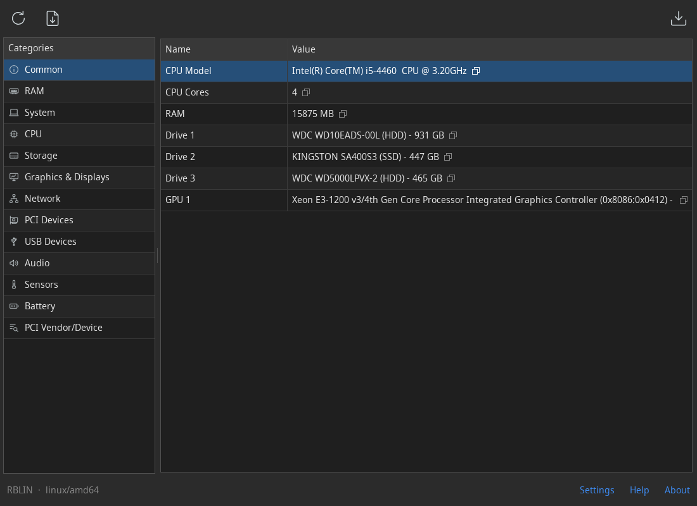

# AltSysInfo

A desktop viewer of hardware and system information. It shows the CPU,
memory, drives and volumes, graphics and displays, network adapters,
PCI and USB devices, audio, sensors and battery of the computer, and
saves a summary as a PDF report. It runs on Linux, Windows and macOS as a
single binary, and on Linux it works without root rights.

Website and documentation: https://altbins.pro/altsysinfo/



## Features

- **Categories.** Common, RAM, System, CPU, Storage, Graphics & Displays,
  Network, PCI Devices, USB Devices, Audio, Sensors and Battery.
- **Copy.** Any value is copied to the clipboard with one click.
- **PDF report.** The CPU, memory, drives and graphics in one document, to
  attach to a support request or keep with the computer's papers.
- **PCI lookup.** Find a vendor or device by its ID or name in the
  built-in PCI ID database, without the internet.
- **Interface.** System tray, always on top, keyboard shortcuts, light
  and dark themes, 31 languages.
- **One copy at a time.** Starting AltSysInfo again brings the running
  window to the front, even from the tray.

## Installation

Download a build for your system from the
[releases](https://github.com/ipoluianov/altsysinfo/releases):

- **Windows:** `altsysinfo.exe`.
- **macOS** (Apple Silicon): the `.dmg` image.
- **Linux** (x86-64 and ARM64): a `.deb` or `.rpm` package, or a user-level
  install (no root) that picks the build for your machine:

  ```sh
  curl -fsSL https://github.com/ipoluianov/altsysinfo/releases/latest/download/linux-install.sh | bash
  ```

Settings are stored in `~/.altbins/.altsysinfo/`. Removing the application
leaves them in place.

### Windows

The exe is not signed, so on the first start SmartScreen may say "Windows
protected your PC". Click **More info**, then **Run anyway**.

A downloaded copy offers to install itself into `%USERPROFILE%\.altbins`
with the **Install** link in the status bar. It adds AltSysInfo to the
Start menu, the desktop and "Installed apps". When a newer version is
started from a download, the link reads **Update**. Remove AltSysInfo
from "Installed apps" or with the **Uninstall** link.

### macOS

Open the `.dmg` and drag AltSysInfo to Applications. The app is signed
and notarized by Apple, so it starts without warnings.

### Linux

- **Without root.** The information comes from `/proc`, `/sys` and the
  udev database. Only the memory modules may need root: where udev has
  no data about them, they are read from the SMBIOS table, which only
  root can read.
- **System tray.** AltSysInfo shows a StatusNotifierItem icon. KDE, XFCE
  and Cinnamon show it as is; GNOME needs the
  [AppIndicator](https://extensions.gnome.org/extension/615/appindicator-support/)
  extension. Without a tray, "minimize to tray" minimizes the window.
- **Display.** AltSysInfo needs X11, and runs under Wayland through
  XWayland, which GNOME and KDE have. glibc-based distributions only (not
  Alpine).
- **Uninstall.** Packages are removed by the package manager. A user-level
  install adds **Uninstall** to the menu entry (right-click) and leaves
  `~/.altbins/.altsysinfo-uninstall.sh`.

## Building

You need Go (see the version in [go.mod](go.mod)). No cgo is required.

```sh
go build .
```

`build/all.sh` (or `build/all.bat`) builds every platform into `bin/`,
together with the deb/rpm packages, the dmg and the installer script.
On macOS the dmg is signed with the Developer ID from the login keychain
(`MACOS_SIGN_IDENTITY`), and `build/all.sh` notarizes it with the `notary`
profile of `xcrun notarytool store-credentials` (`MACOS_NOTARY_PROFILE`).
`build/notarize.sh` notarizes the dmgs of the newest build on its own.
Without the certificate the dmg is built unsigned.

## License

[MIT](LICENSE) © Ivan Poluianov
